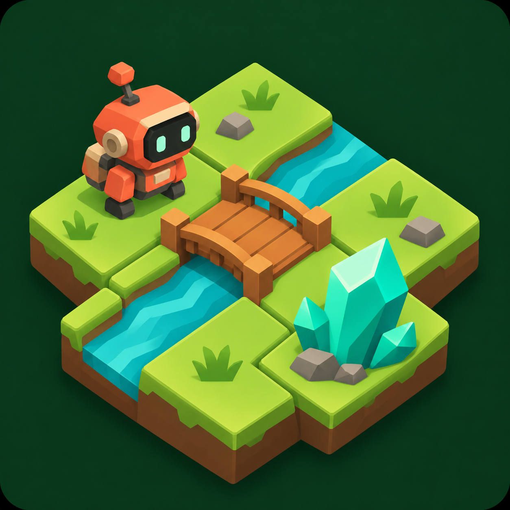
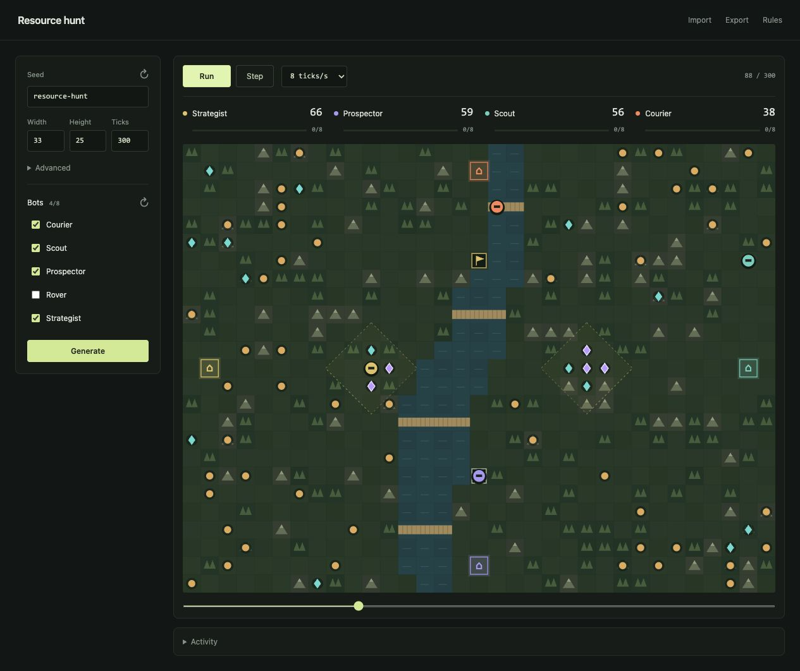
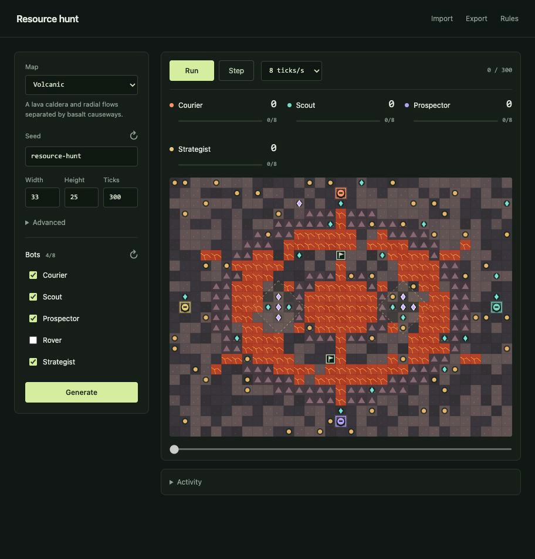

<p align="center">
  
</p>

<h1 align="center">Resource Hunt</h1>

<p align="center">
  <a href="https://www.typescriptlang.org/"></a>
  <a href="https://nodejs.org/"></a>
  <a href="https://yarnpkg.com/"></a>
  <a href="https://tsx.is/"></a>
  <a href="https://esbuild.github.io/"></a>
</p>

A TypeScript simulator for building and comparing resource-hunting bots. Compete on seeded grid maps, carry resources home, and finish with the highest banked score.

Watch matches in the browser or run headless benchmarks. Both use the same game engine.

## Screenshots

| Riverlands | Volcanic |
| ---------- | -------- |
|  |  |

## Run

Requires Node.js **22.18+** and Yarn **1.22.22**.

```sh
yarn install
yarn dev
```

Open [localhost:3000](http://127.0.0.1:3000). Use `PORT=3100 yarn dev` to change the port.

Select up to 15 bots, choose a map, then run, pause, or step through the match. The timeline lets you review completed ticks. Import and export replays to inspect runs later.

## Benchmark

```sh
# List available bots
yarn bots

# Run one match
yarn play --biome volcanic --seed training --ticks 300

# Compare strategies across maps and base positions
yarn bench --bots nearest,prospector,courier,strategist --matches 20 --seed training

# Save JSON results and a replay
yarn --silent play --seed training --json \
  --output results/match.json --replay results/replay.json

# Pipe benchmark results into your own analysis
yarn --silent bench --matches 20 --json > results.json
```

Benchmarks rotate bots through every base on each map. Use a match count divisible by the bot count for balanced comparisons. Results include scores, ranks, wins, and bot errors.

Keep seeds, opponents, and settings fixed when comparing bot versions. Run `yarn play --help` for all options. Exit codes are `0` for success, `1` for run failures, and `2` for bot or discovery errors.

## Maps

Eight seeded templates change both the terrain and the routes bots must take:

| Map         | Layout                                                    |
| ----------- | --------------------------------------------------------- |
| Riverlands  | Winding river with wide, bank-to-bank bridges             |
| Valley      | One valley branch per player, cliff ridges, shared passes |
| Desert      | Slow dune bands, rocky mesas, scattered oases             |
| Moon        | Crater basins, broken rims, lunar plains                  |
| Volcanic    | Lava caldera, radial flows, basalt causeways              |
| Archipelago | Islands with equal crossings and bridge access            |
| Tundra      | Slow snowfields and fast frozen-lake routes               |
| Forest      | A maze of paths and clearings through dense thickets      |

Choose **Map** in the UI or use `--biome valley` in either CLI command. Riverlands is the default. The same biome, seed, dimensions, and settings reproduce the same map. Roughness adjusts each template's terrain mix; it preserves the template's defining features.

Starts have fast, theme-appropriate clearings and equal opening supplies. Terrain generation accounts for the player count: each player gets a valley branch, oasis, or crater start where appropriate. Archipelago crossings have equal lengths, and every base starts two moves from a bridge. Hotspots vary by seed and terrain, favoring sites contestable by multiple players and spreading opportunities between players.

The default 33 × 25 map supports 15 bots. Crowded lineups require larger minimum dimensions; the UI adjusts them automatically, and the CLI reports the minimum when needed.

Bots read `state.config.biome` and use the existing cost and pathfinding helpers on every map. See [map generation and terrain costs](docs/maps.md).

## Add a bot

Create `bots/my-bot.ts`. Default-exported classes are discovered automatically; refresh the UI or start a CLI run.

```ts
import { findPath, samePosition, type Action, type Bot, type Observation } from "../src/sdk.ts";

export default class MyBot implements Bot {
  static metadata = {
    id: "my-bot",
    name: "My bot",
    description: "Collects one resource, then returns home.",
  };

  act(state: Observation): Action {
    const { self, map, resources } = state;
    if (self.inventory.length) return { type: "home" };
    if (resources.some((pile) => samePosition(pile, self.position))) return { type: "grab" };

    const target = resources[0];
    const direction = target && findPath(map, self.position, target)?.steps[0];
    return direction ? { type: "move", direction } : { type: "skip" };
  }
}
```

Each `act(state)` receives a fresh snapshot of the full map, remaining resources, every bot, your inventory, settings, and remaining ticks. Turns resolve sequentially, so later bots see earlier decisions. Keep memory in class fields.

Return `move` with direction `N`, `W`, `E`, or `S`, or return `grab`, `skip`, `home`, `capture`, or `steal` with a `targetId`. `home` takes one step toward the nearest owned bank. Arrival at your base or an owned outpost banks cargo automatically.

The [SDK reference](docs/sdk.md) documents every helper, action, state field, and exported type, with examples for movement costs, pathfinding, and inventory. Start with the [included bots](bots/) for stronger strategies. `Math.random` is seeded per bot. Helpers beginning with `_` and test files are excluded from discovery; bot IDs must be unique lowercase letters, digits, or hyphens.

Workers enforce decision timeouts. Bots run with local Node.js filesystem and network permissions.

## Rules

Defaults: **33 × 25 grid, 300 ticks, four bots, capacity 8, 100 ms per decision**.

- Each tick gives every bot a turn; starting order rotates.
- Terrain costs 1–3 turns. Water, cliffs, lava, and thickets block movement.
- Every map keeps bases, resources, and outposts reachable.
- Grab collects one unit if it fits. Resources do not respawn.
- Finite crystal/relic hotspots concentrate valuable supplies at terrain-aware locations.
- Capture outposts with three consecutive uncontested `capture` turns. Owners can bank there; rivals can reclaim them. Leaving, taking another action, or an active rival entering interrupts capture.
- `steal` transfers one highest-value fitting item from a bot on your tile. Base tiles are safe. Successful theft has a five-tick cooldown; both participants are protected through the next tick.
- Bots share tiles without movement blocking.
- Only banked resources score. Ties share a rank; unbanked inventory earns nothing.
- Invalid decisions cost a turn. A timed-out bot is disabled for the match.

Hotspots, outposts, and theft are enabled by default. The default lineup includes [Strategist](bots/strategist.ts), which captures outposts and steals exposed cargo. Adjust these settings under Advanced in the UI or through the CLI:

```sh
yarn play --hotspots 3 --outposts 2 --capture-turns 3 --steal-cooldown 5
yarn play --hotspots 0 --outposts 0 --stealing false
```

JSON standings and benchmarks include captures, outposts owned, stolen units, and lost units. Existing bots remain valid; old replays import with competition disabled.

| Resource | Value | Weight |
| -------- | ----: | -----: |
| Ore      |     2 |      1 |
| Crystal  |     7 |      2 |
| Relic    |    14 |      3 |

## Development

```sh
yarn run check  # Formatting, TypeScript, and tests
yarn format     # Format the codebase
yarn start      # Run without watching
yarn build      # Export browser assets to dist/
```

`yarn dev` watches source changes; reload the browser after edits. Matches require the local server, including when using the exported browser assets.

Game rules live in [`src/engine/`](src/engine/), bot execution and benchmarks in [`src/runtime/`](src/runtime/), and the UI in [`src/web/`](src/web/). Use [`src/index.ts`](src/index.ts) to run the engine from your own scripts.

Runtime dependencies are limited to `tsx` and `esbuild`. Tests use Node's built-in runner. Use `yarn install --frozen-lockfile` in CI.

## License

MIT — see [LICENSE](LICENSE).
